<p align="center">
  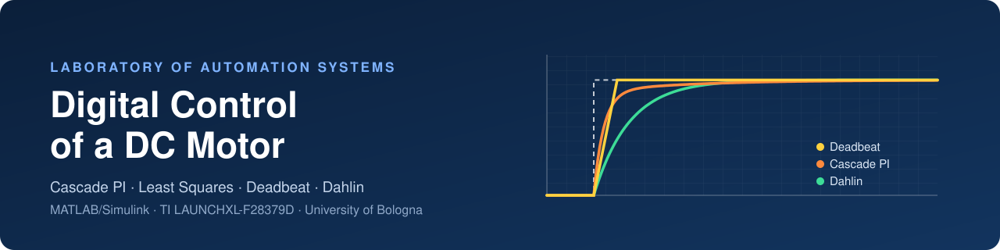
</p>

<p align="center">
  
  
  
  
  <a href="LICENSE"></a>
</p>

<p align="center">
  <b>From a datasheet model to a robust deadbeat controller, on real hardware.</b><br>
  Design, discretization and experimental validation of four digital speed controllers for a DC motor,<br>
  running in real time on a Texas Instruments C2000 microcontroller.
</p>

<p align="center">
  <a href="report/LAS_Report_Gallo_Ragazzini_Lodolini.pdf"><b>Full report (PDF, 78 pages)</b></a> ·
  <a href="#final-comparison">Results</a> ·
  <a href="#getting-started">Getting started</a> ·
  <a href="#repository-structure">Repository structure</a>
</p>

---

## Highlights

- **Four controllers, one real motor**: cascade PI with feedforward, gain-scheduled PI on identified parameters, **Deadbeat** and **Dahlin**, all executed on a LAUNCHXL-F28379D at **10 kHz**.
- **The datasheet was wrong**: least-squares identification found an armature inductance **≈ 50 % higher** than nominal (6.1 mH vs 4.1 mH). The model built on the estimated parameters overlaps the measured current transient almost exactly.
- **Asymmetric friction**: the identification showed that viscous friction is **14.1 % higher** in one direction of rotation. It is modelled with a velocity-dependent PCHIP map $b(\omega)$ that drives gain scheduling of the speed PI.
- **A deadbeat that actually works**: the unconstrained deadbeat asks for **±2700 V** with violent ringing. A custom polynomial anti-windup $F(z)$ makes it the **best performer** on the real motor, with the fastest rise, no overshoot and robustness to load.
- **Steady-state ripple of ±4 rpm at 1000 rpm** (< 0.5 %), limited by encoder quantization and PWM ripple.

## Table of contents

- [Experimental setup](#experimental-setup)
- [Control architecture](#control-architecture)
- [1 · Modelling and speed filtering](#1--modelling-and-speed-filtering)
- [2 · Cascade PI control](#2--cascade-pi-control)
- [3 · Least-squares parameter identification](#3--least-squares-parameter-identification)
- [4 · Deadbeat controller](#4--deadbeat-controller)
- [5 · Dahlin controller](#5--dahlin-controller)
- [Final comparison](#final-comparison)
- [Repository structure](#repository-structure)
- [Getting started](#getting-started)
- [Authors](#authors)
- [License](#license)

---

## Experimental setup

<table>
<tr>
<td width="48%">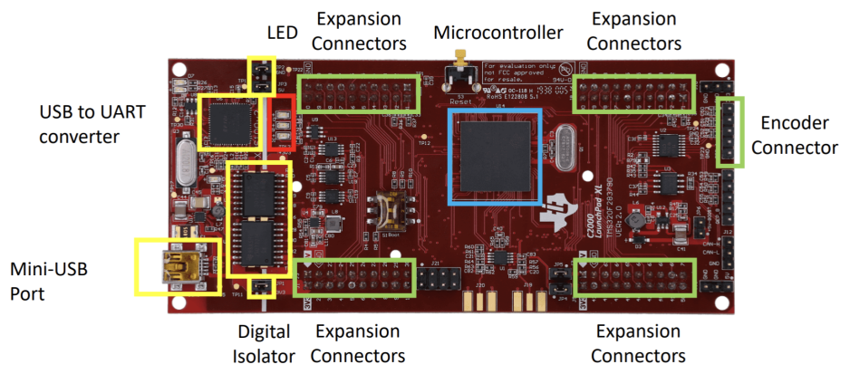</td>
<td>

| | |
| --- | --- |
| **Controller** | TI LAUNCHXL-F28379D (C2000 Delfino, 200 MHz) |
| **Plant** | DC motor, shaft-coupled to a second machine acting as a load (braking resistors) |
| **Sensor** | Incremental encoder, 2048 CPR → **8192 counts/rev** (quadrature) |
| **Actuator** | PWM power stage at **10 kHz**, DC link 24 V (PI) / 32 V (deadbeat, Dahlin) |
| **Sampling** | $T_s = 100\ \mu s$, synchronous with the PWM |
| **Toolchain** | Simulink → Embedded Coder → C2000, host interface over serial |

</td>
</tr>
</table>

At 1500 rpm the encoder produces only about 20 counts per sample, so **a single count is about 5 % of the measured speed**. This is why the speed feedback must be filtered.

## Control architecture

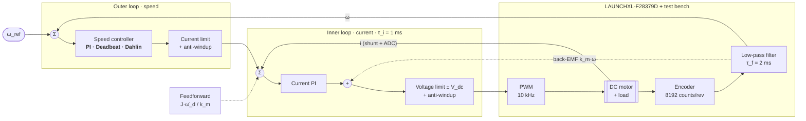

Every saturation block has its own **anti-windup**: back-calculation for the PI loops, and a polynomial $F(z)$ scheme for the deadbeat and Dahlin controllers.

---

## 1 · Modelling and speed filtering

The motor is modelled as two coupled first-order subsystems:

```math
v_a = R_a\, i_a + L_a \frac{di_a}{dt} + k_m\,\omega, \qquad J\,\dot\omega + b\,\omega = k_m\, i_a
```

The raw encoder speed is filtered by a first-order low-pass filter, discretized with backward Euler:

```math
\omega_f[k] = \frac{T_s}{T_s+\tau_f}\,\omega_m[k] + \frac{\tau_f}{T_s+\tau_f}\,\omega_f[k-1], \qquad \tau_f = 2\ \text{ms}
```

The time constant $\tau_f = 2$ ms was chosen experimentally. With $\tau_f = 20$ ms the filter delay destabilizes the speed loop, causing overshoot and oscillations.

📂 [`01_DC_Motor_Model_and_PWM`](01_DC_Motor_Model_and_PWM) · [`02_Base_Model_and_Encoder`](02_Base_Model_and_Encoder)

## 2 · Cascade PI control

Both PI controllers are tuned by **pole-zero cancellation**, so that each closed loop behaves like a first-order system. The speed loop is chosen 10× slower than the current loop:

| Loop | Design rule | Target | Gains (nominal model) |
| --- | --- | --- | --- |
| Current | $T_{ii} = L_a/R_a,\quad K_{pi} = L_a/\tau_i$ | $\tau_i = 1$ ms | $T_{ii} = 1.28$ ms, $K_{pi} = 4.1$ |
| Speed | $T_{i\omega} = J/b,\quad K_{p\omega} = J/(\tau_\omega k_m)$ | $\tau_\omega = 10$ ms | $T_{i\omega} = 85$ ms, $K_{p\omega} \approx 0.064$ |

Both controllers are discretized with **Tustin** and implemented in incremental form inside a MATLAB Function block. On saturation, the clamped output is stored as the controller state, which acts as the anti-windup:

```matlab
out = (Kp*Ts/(2*Ti))*(in + in_prev) + Kp*(in - in_prev) + out_prev;
out = min(max(out, LowSat), HiSat);   % saturation
out_prev = out;  in_prev = in;        % anti-windup: store the saturated value
```

For trajectory tracking, a **feedforward current** $i_{ff} = J\,\dot\omega_d / k_m$ removes most of the lag on ramps.

<table>
<tr>
<td width="50%" align="center">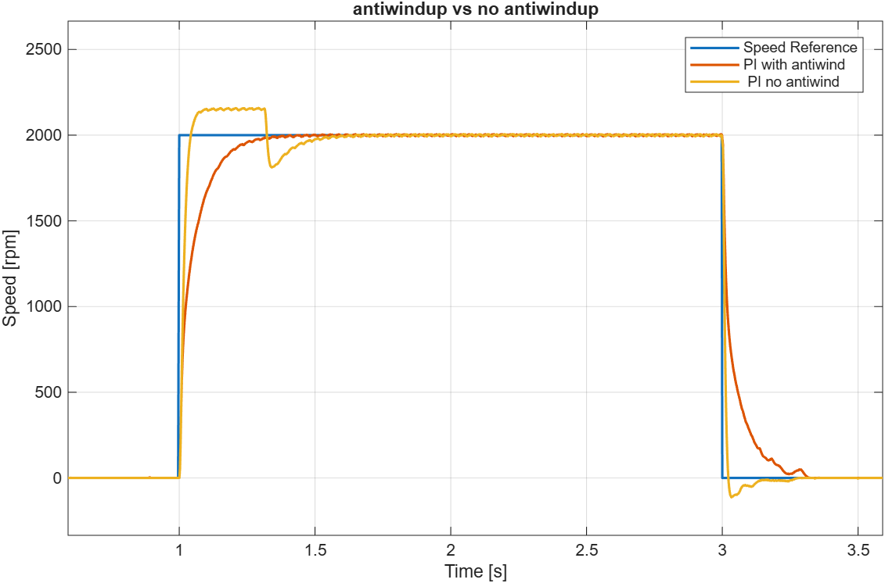<br><sub>2000 rpm step: anti-windup removes the overshoot and the undershoot at the falling edge</sub></td>
<td width="50%" align="center">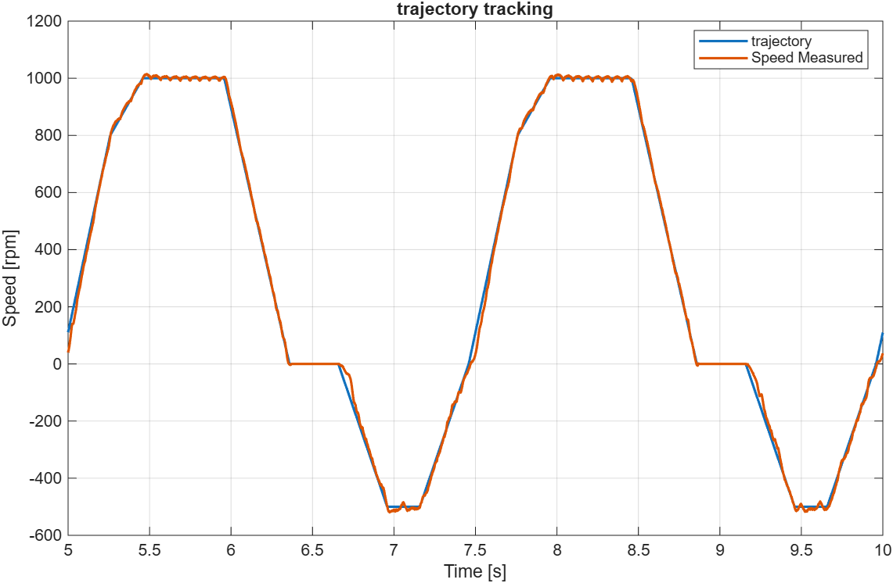<br><sub>Tracking a trapezoidal trajectory with positive and negative speeds</sub></td>
</tr>
</table>

📂 [`03_PI_Current_Control`](03_PI_Current_Control) · [`04_PI_Speed_Control`](04_PI_Speed_Control) · [`05_Trajectory_Tracking`](05_Trajectory_Tracking)

## 3 · Least-squares parameter identification

Each subsystem is discretized with backward Euler into the regression form $y(k) = \alpha_1 y(k-1) + \alpha_2 u(k)$. The parameters are then estimated offline:

```math
\hat\theta = (\Phi^\top \Phi)^{-1} \Phi^\top Y, \qquad \phi(k) = \begin{bmatrix} y(k-1) \\ u(k) \end{bmatrix}, \quad \theta = \begin{bmatrix} \alpha_1 \\ \alpha_2 \end{bmatrix}
```

- **Electrical (R, L)**: a voltage step is applied and the current is sampled for 1000 samples, *before the rotor starts moving* (so the back-EMF is zero). This gives $R = (1-\alpha_1)/\alpha_2$ and $L = \alpha_1 T_s/\alpha_2$.
- **Mechanical (J, b)**: square-wave tests from 14 V to 48 V, with torque $k_m i$ as input and $\omega$ as output, over 20 000 samples. $J$ is averaged over the unsaturated tests.

| Parameter | Nominal | Estimated |
| --- | --- | --- |
| Armature resistance $R$ | 3.2 Ω | **3.1532 Ω** |
| Armature inductance $L$ | 4.1 mH | **6.1 mH** (+49 %) |
| Equivalent inertia $J$ (2 coupled machines) | 7.04 × 10⁻⁵ kg·m² | **8.127 × 10⁻⁵ kg·m²** |
| Viscous friction $b$ | 6.65 × 10⁻⁴ N·m·s/rad | **non-linear, asymmetric** $b(\omega)$ |

Unidirectional tests at 20 V gave $b_{pos} = 9.62 \times 10^{-4}$ and $b_{neg} = 8.43 \times 10^{-4}$ N·m·s/rad, a **14.1 % asymmetry**. Swapping the motor terminals confirmed it is mechanical (wear) and not electrical. The steady-state points were interpolated with **PCHIP** into a 1-D lookup table. The table also schedules the integral time of the speed PI, $T_{i\omega}(\omega) = J/b(\omega)$.

<table>
<tr>
<td width="50%" align="center">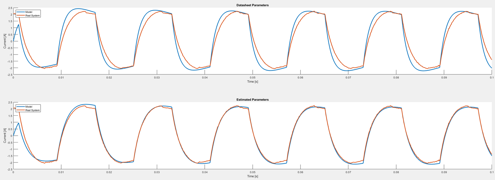<br><sub>Current transient: datasheet model (top) vs. identified model (bottom) against the real motor</sub></td>
<td width="50%" align="center">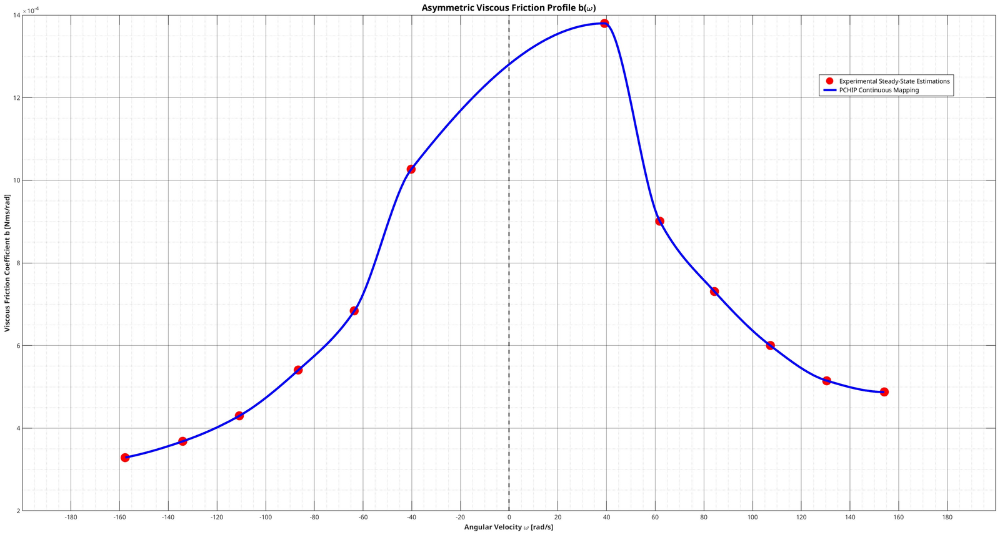<br><sub>Identified asymmetric friction profile b(ω), PCHIP interpolation</sub></td>
</tr>
</table>

📂 [`06_Least_Squares_Estimation`](06_Least_Squares_Estimation)

## 4 · Deadbeat controller

The deadbeat controller is synthesized **directly in the z-domain**. The plant (estimated parameters, $V_{dc} = 32$ V) is discretized with ZOH. The closed loop is then forced to $G_m(z) = z^{-k_d}$, with $k_d = 1$, the plant's relative degree:

```math
D(z) = \frac{1}{G_p(z)}\,\frac{z^{-k_d}}{1 - z^{-k_d}}
```

Unconstrained, the controller requests **±2700 V** with alternating-sign ringing. A polynomial anti-windup replaces the controller denominator with a stable $F(z)$ during saturation:

```math
F(z) = K_f\, z\,(z - 0.95)(z - 0.8), \qquad K_f = 100, \qquad \deg F \ge \deg B_z, \quad \frac{B_z(1)}{F(1)} \ge 0
```

<table>
<tr>
<td width="50%" align="center">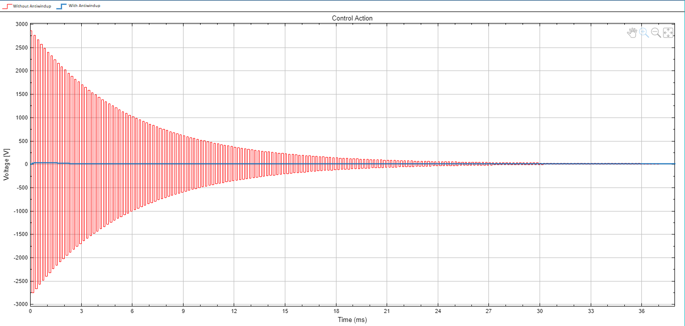<br><sub>Simulated control effort: unconstrained deadbeat (red, ±2700 V ringing) vs. anti-windup (blue)</sub></td>
<td width="50%" align="center">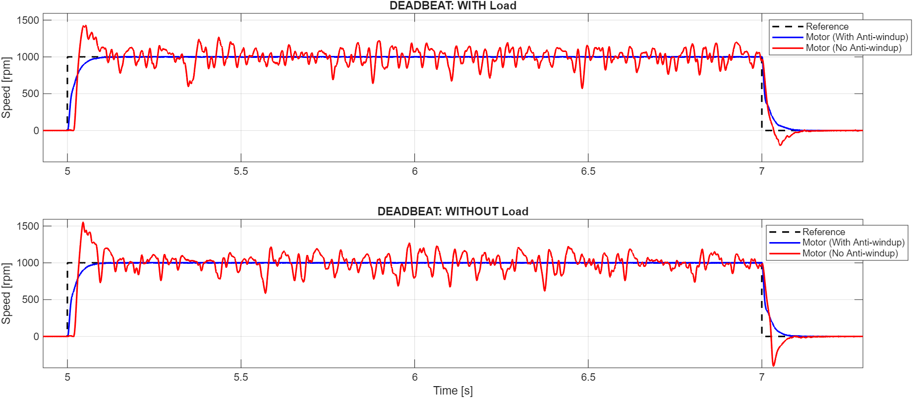<br><sub>Real motor, 0 → 1000 rpm, with and without load: anti-windup (blue) vs. none (red)</sub></td>
</tr>
</table>

Without anti-windup, the real motor overshoots past **1500 rpm** and shows a delayed "bump" below zero after the falling edge. With $F(z)$, the response is monotonic and flat.

📂 [`07_Deadbeat_Controller`](07_Deadbeat_Controller)

## 5 · Dahlin controller

The Dahlin controller relaxes the deadbeat specification. Instead of a pure delay, the closed loop must behave like a delayed first-order system with time constant $\lambda$:

```math
D(z) = \frac{1}{G_p(z)}\;\frac{(1-e^{-T/\lambda})\,z^{-N-1}}{1 - e^{-T/\lambda} z^{-1} - (1-e^{-T/\lambda})\,z^{-N-1}}, \qquad N = 1
```

$\lambda = 20$ ms was chosen as the trade-off between speed and control effort. The same $F(z)$ anti-windup structure is used. On the real motor, the measured 63 % rise time is **23 ms without anti-windup** and **29.7 ms with it**, close to the 20 ms design value. The extra 7 ms is the cost of bounded internal states.

<table>
<tr>
<td width="50%" align="center">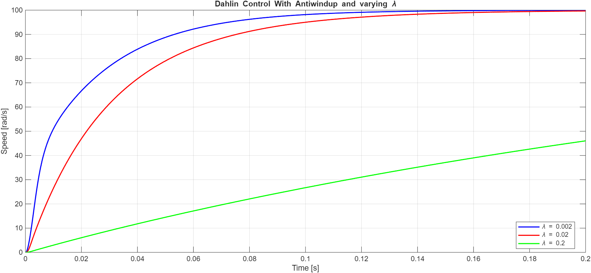<br><sub>Effect of λ on the speed response</sub></td>
<td width="50%" align="center">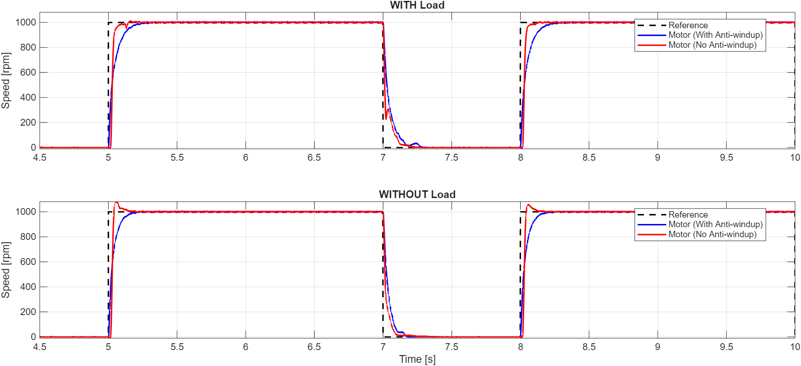<br><sub>Real motor, with and without load and anti-windup</sub></td>
</tr>
</table>

📂 [`08_Dahlin_Controller`](08_Dahlin_Controller)

---

## Final comparison

The best version of each controller was tested on the same 0 → 1000 → 0 rpm sequence, with and without load.

<table>
<tr>
<td width="50%" align="center">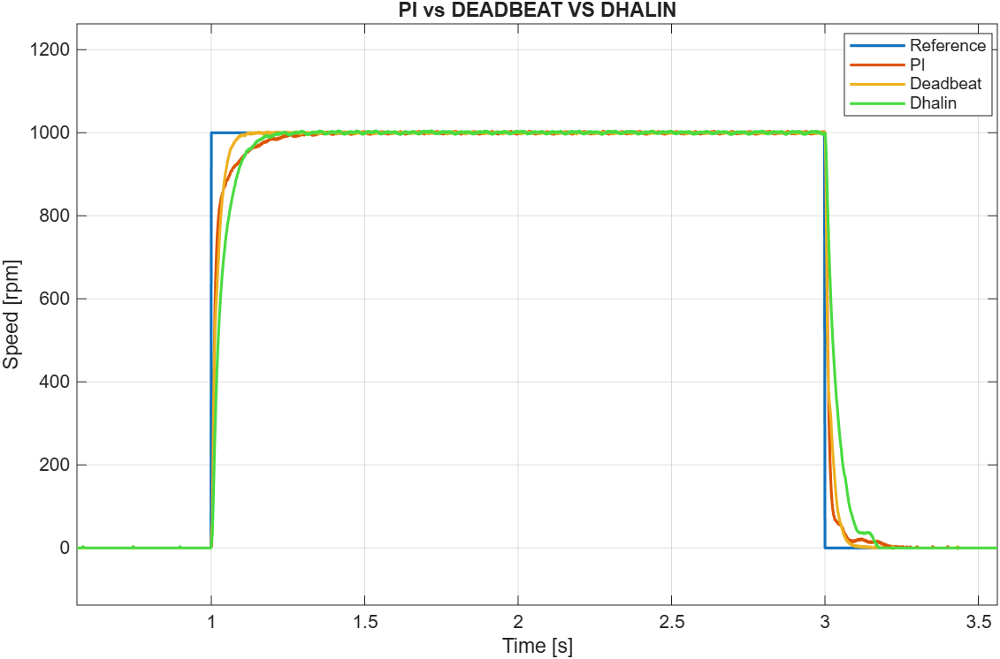<br><sub><b>Without load</b></sub></td>
<td width="50%" align="center">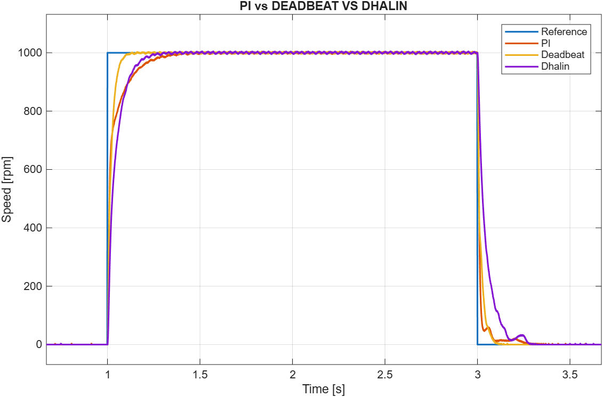<br><sub><b>With load</b></sub></td>
</tr>
<tr>
<td width="50%" align="center">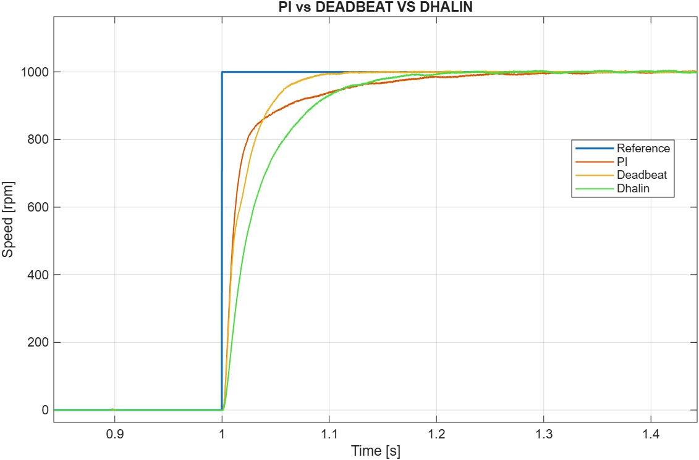<br><sub>Rising edge (no load)</sub></td>
<td width="50%" align="center">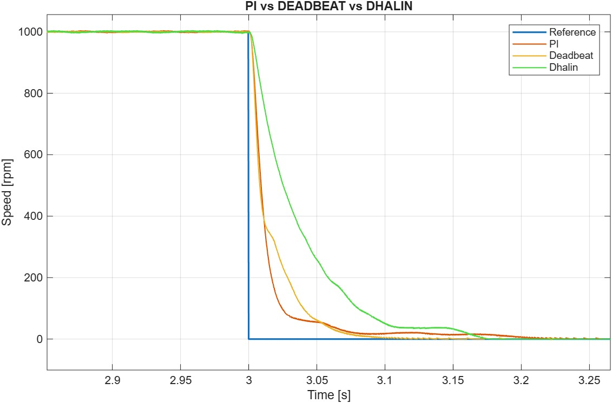<br><sub>Falling edge (no load)</sub></td>
</tr>
</table>

| | Cascade PI | Deadbeat | Dahlin |
| --- | :---: | :---: | :---: |
| **Synthesis** | continuous-time, Tustin | direct discrete, $k_d = 1$ | direct discrete, $\lambda = 20$ ms |
| **Rise time** | fast start, long tail | 🥇 fastest | smooth exponential |
| **Overshoot** | none | none | none |
| **Falling edge** | small bump near zero | 🥇 sharp, no undershoot | deceleration plateau |
| **Robustness to load** | slower settling | 🥇 virtually unaffected | most degraded |
| **Control effort** | moderate | highest (relies on $F(z)$) | 🥇 lowest |
| **Verdict** | best performance / hardware-stress compromise | **best overall** | when smoothness matters more than speed |

> **Takeaway:** an aggressive discrete-time controller is only usable if saturation is handled correctly. Paired with a well-tuned anti-windup polynomial, the deadbeat goes from theoretically fragile to the most effective controller on this setup.

---

## Repository structure

```
.
├── 01_DC_Motor_Model_and_PWM/      Continuous-time motor model, PWM generation and sampling
├── 02_Base_Model_and_Encoder/      Base hardware model: ADC, encoder, PWM on the F28379D
├── 03_PI_Current_Control/          Inner current loop
├── 04_PI_Speed_Control/            Cascade PI (current + speed) with anti-windup
├── 05_Trajectory_Tracking/         Trajectory tracking with feedforward
├── 06_Least_Squares_Estimation/
│   ├── acquisition_model/          Firmware used to log the identification data
│   ├── LR_estimation/              R, L estimation script, validation model, figures
│   ├── Jb_estimation/              J, b estimation script, validation model, figures
│   └── data/                       Raw acquisitions (14 V to 48 V, reversed motor, unidirectional)
├── 07_Deadbeat_Controller/
│   └── results/                    simulation/ and experimental/ data, plots, scripts
├── 08_Dahlin_Controller/
│   └── results/                    simulation/, lambda_tuning/ and experimental/
├── docs/images/                    Figures used in this README
└── report/                         Final project report (PDF)
```

Each module folder is **self-contained**: the models sit next to the parameter scripts they need, so you only have to `cd` into the folder.

## Getting started

### Requirements

- **MATLAB / Simulink R2024b** (all models are saved with this release)
- **Embedded Coder** + **C2000 Microcontroller Blockset** (hardware deployment)
- **Control System Toolbox** (`c2d`, `minreal`, transfer functions)
- Hardware, only for the experimental part: LAUNCHXL-F28379D, DC motor with encoder and a power stage

### Run a simulation

```matlab
cd 08_Dahlin_Controller
Lez_11_DahlinModel_Parameters_Student      % loads parameters and synthesizes D(z), F(z)
open_system('DahlinModel_Student')          % press Run
```

### Run on the real motor

1. `cd` into the module and run its parameter script. Set `comport` to the board's serial port.
2. Open the **target model** (e.g. `Lez_11_basePerTracing.slx`) and click *Build, Deploy & Start* on the LaunchPad.
3. Open **`CommandInterface.slx`** on the host and run it to send speed references and log data over serial.

| Module | Parameter script | Simulation model | Target model (board) |
| --- | --- | --- | --- |
| 01 | `param.m`, `C01A_Parameters.m` | `DCMotor.slx`, `C01A_DC_MotorEquation.slx`, `PWM_Sampling.slx` | `PWMAudible.slx`, `PWM_Lez_2.slx` |
| 02 | `BaseModelForControl_Parameters.m`, `DC_MotorEquation_Encoder_Parameters.m`, `param.m` | `DC_MotorEquation_Encoder.slx`, `DCMotor.slx` | `BaseModelForControl.slx` |
| 03 | `param.m` | `DCMotor.slx` | |
| 04 | `BaseModelForControl_Parameters.m` | | `BaseModelForControl.slx`, `BaseModelForControlPid.slx` |
| 05 | `Lez_6_Parameters.m` | | `Lez_6_BasePerTracing.slx` (+ `Lez_6_CommandInterface.slx`) |
| 06 | `acquisition_model/Our_parameter_new.m` | `LR_Model.slx`, `Jb_Model.slx` | `Lez_9_BasePerTracing.slx` |
| 07 | `Lez_10_parameters.m` / `DeadBeatModel_Parameters_Student.m` | `DeadbeatModel_Student.slx` | `Lez_10_basePerTracing.slx` |
| 08 | `Lez_11_DahlinModel_Parameters_Student.m` | `DahlinModel_Student.slx` | `Lez_11_basePerTracing.slx` |

### Reproduce the identification and plots

```matlab
cd 06_Least_Squares_Estimation/LR_estimation
LR_estimation_DCMotor      % R, L + validation against the datasheet model
cd ../Jb_estimation
Jb_estimation_DCMotor      % J, b + validation
```

Every `results/` folder contains the raw `.mat` logs and a `plot_*.m` script that regenerates its figures.

---

## Authors

<table>
<tr>
<td align="center"><b>Andrea Gallo</b></td>
<td align="center"><b>Vittorio Ragazzini</b></td>
<td align="center"><b>Leonardo Lodolini</b></td>
</tr>
</table>

M.Sc. in Automation Engineering, **Alma Mater Studiorum, University of Bologna**.
Developed for the course *Laboratory of Automation Systems* (A.Y. 2025/2026), held by Prof. Claudio Melchiorri and Prof. Davide Samorì.

## License

The code and documentation written by the authors are released under the [MIT License](LICENSE).

Some Simulink templates (the `*_Student` models and the base hardware models) were provided as course material and then completed by the authors. `mcb_pmsm_foc_qep_f28379d_data.m` is © The MathWorks, Inc. and is **not** covered by the MIT license.
